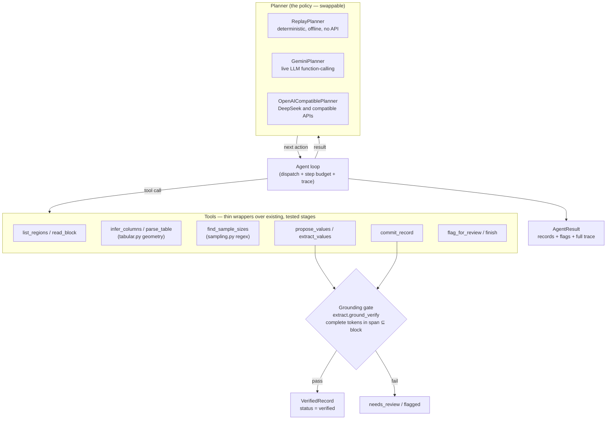

# Agent layer — bounded autonomy over the tiered pipeline

> Status: **scaffolding**. The loop, tools, grounding gate, and offline policy are
> implemented and tested; the live LLM policy is implemented but not measured at
> scale. This document describes what the agent *is* and, just as importantly,
> what it is deliberately *not allowed* to do.

## What this is

`metaextract.agent` is an autonomous **tool-use loop** that assembles
treatment-vs-control records from a paper that has already been screened and
located. Instead of a human clicking each located region in the cockpit, a
*planner* decides the next action, the loop runs the corresponding tool, and the
result feeds the next decision — a real perceive → act loop.

## What this is **not**

It is not a new, higher-trust way to read numbers. The project's core finding is
that a silent transcription error is the most expensive failure in a
meta-analysis, so AI is **never** allowed to commit a number the source does not
support. The agent inherits that rule unchanged: every value it commits passes the
same deterministic grounding gate (`extract.ground_verify`) the cockpit uses, and
a value that cannot be grounded is flagged for a human, never silently written.

The agent can choose *what to do next*. It cannot choose to *trust a number the
source does not support*. That is the whole design.

## Architecture



The loop is intentionally dumb — it has no judgement, only a step budget. The
bounded-autonomy guarantee lives in the **tools**, not the loop: `commit_record`
sets a record's status from `gate.record_status`, never from the model.

## The tools

| Tool | Wraps | Purpose |
| --- | --- | --- |
| `list_regions` | `LocateOutput` | the already-located target regions |
| `read_block` | `SourceDoc` | one block's text + numeric tokens |
| `infer_columns` | `tabular.column_count` | how many value columns a table block has (label-free) |
| `parse_table` | `tabular.parse_block` + `make_pairings` | rows × columns → control×treatment candidates |
| `find_sample_sizes` | `sampling.find_sample_size_candidates` | deterministic replicate-count (n) candidates |
| `ground_check` | `extract.ground_verify` | probe the gate for one value **without** committing it |
| `propose_values` | `extract.apply_grounding` | submit values; each is gated before storage |
| `extract_values` | `extract.extract_region` | **Gemini-only today** Tier-3: model reads the block, then the gate runs; hidden when no compatible Tier-3 client is configured |
| `commit_record` | `gate.assemble_record` | materialize a `VerifiedRecord`; status comes from the gate |
| `flag_for_review` | — | hand a region to a human instead of committing |
| `finish` | — | end the run |

## The planners

All drive the same **core** tools and the identical gate, so autonomy is bounded
the same way regardless of who is steering. The optional Gemini-only
`extract_values` shortcut is the one provider-specific tool today.

- **`ReplayPlanner`** — a deterministic policy that reacts to real tool output
  (column count, parsed candidates). Written as a generator so it reads like a
  script while still being a genuine perceive→act loop. Needs no API key, so it
  runs the demo and the test suite in CI. It uses generic column labels
  (`col1`/`col2`) and is a *baseline* policy, not a claim of correct pairing.
- **`GeminiPlanner`** — the live LLM policy via Gemini function-calling. It can
  supply real column labels and use `extract_values`. Implemented for the
  `--online` path; not exercised in CI.
- **`OpenAICompatiblePlanner`** — one shared adapter for OpenAI-style chat tool
  calls. DeepSeek is configuration on this adapter, not another planner class.
  It reads blocks and submits values through `propose_values`, so the same
  grounding gate still decides whether records are verified.

## What the gate catches — and what it does not

The grounding gate catches the failures the model's own confidence cannot:

- a **hallucinated number** (not present in the cited block) → rejected
- a value **spliced from a different table** (its evidence span isn't in the
  cited block) → rejected
- a non-numeric value painted as a measurement → rejected

For a record to be `verified`, every required field in the selected analysis
family must also be present. This is still a grounding status, not a proof of
correct row/column identity or human approval.

It does **not** catch a number that is real but assigned to the **wrong row** —
e.g. a block that merges `pH + Moisture + Total N` into one region, where the
first row's (real) values could be handed to all three variables. The number
grounds; the *identity* is wrong. This is exactly the row-identity matching the
project deliberately leaves to a human (Architecture v3.1). So the agent does not
guess it: when `parse_table` returns more than one row, the policy
`flag_for_review`s the region (`multi_row_block_needs_row_assignment`) instead of
committing. The demo below shows this happening on a real paper.

## Running it

Offline (no API key), over a cached paper:

```bash
python scripts/agent_demo.py P1
# or
metaextract agent P1 --report data/outputs/agent_run_P1.json
```

Live Gemini policy (same tools, same gate):

```bash
metaextract agent P1 --online
```

Live DeepSeek policy:

```bash
export DEEPSEEK_API_KEY="your-api-key"
metaextract agent P1 --provider deepseek --model deepseek-v4-flash
```

For another OpenAI-compatible API, pass `--provider openai-compatible`, its
`--base-url`, and `--model`. `METAEXTRACT_AGENT_MODEL` and
`METAEXTRACT_AGENT_BASE_URL` provide environment-based defaults; `--api-key-env`
selects the key variable when it is not `OPENAI_API_KEY`.

On cached P1 the offline run can assemble candidate records, but records without
all required fields (including sample sizes for the continuous family) remain
`needs_review`; the merged `pH/Moisture/TN` block is also flagged for human
row-assignment. This demonstrates the gate rejecting fabricated or incomplete
values while deferring identity matching it should not automate.

## Relationship to the rest of the system

The agent is an **orchestrator**, not a new tier. It sits on top of:

- **Tier 1/2** (`locate.py`) — screening + locating, run once and cached.
- **Tier 3** (`extract.py`) — Gemini on-demand extraction behind the grounding
  gate. Other planners use `read_block` + `propose_values`; neither path bypasses
  the gate.
- **Deterministic helpers** (`tabular.py`, `sampling.py`) — geometry parsing and
  the n finder, the same code the cockpit uses.

Every record the agent emits is a normal `VerifiedRecord` with per-slot citations,
so its output is as auditable and jumpable as a human's — plus a full tool-call
trace of how each value was accepted or deferred.
